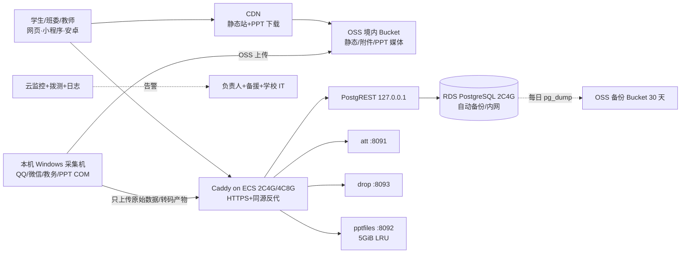

# 03 · 校级推广的运维、成本与容量评估（福建中医药大学）

> 调研员：ops-cost ｜ 完成：2026-11-13 ｜ 范围：**仅本校校级推广**（非多校 SaaS）
> 方法：只读核查仓库文档/审计报告（未连云端、未部署、未读任何密钥；不含 token/学号/姓名）。
> 标注：**【事实】/【文档】**=仓库证据；**【官网价】**=2026-11-13 查阅云厂商官方定价页；**【活动价】**=官方促销口径；**【估算·高/中/低】**=本报告假设；**【需确认】**=证据不足。价格均为人民币、不含人力，来源见 §3.5。

## 0. 结论速览

| 维度 | 结论 | 评级 |
|---|---|---|
| 技术迁移 | 现栈（CloudBase PG+PostgREST+静态站+ECS 反代）可迁 RDS PG/自建 PG，**8–15 人日**，无不可逾越障碍 | 高 |
| 基础设施成本 | 1k/5k/20k 三档 **约 ¥0.15k / ¥0.45k / ¥1.5k–4.5k 每月**（不含人力/合规一次性），远低于采购商业校园系统 | 高 |
| 运维人力 | 现状=1 名学生+家庭 PC+无值班/监控/备份；校级 SLA 需 **1–2 FTE+自动化+值班** | 低-中 |
| 合规一次性 | 主体切换/等保二级/教育移动应用备案约 **¥8–25 万**+2–6 个月流程 | 低（硬约束） |
| **总体** | **有条件可行**：先 1k 学生/1–2 学院试点并解决 CloudBase 到期；不建议直接全校 | ★★★☆☆ |

**3 个最大卡点**
1. **CloudBase 2026-12-10 到期（距今 27 天）+ 无备份/无迁移演练**：`class_verify`/`auth_*`/RLS 不在仓库，换环境不可重建；未续费=网页/小程序/安卓同时中断。
2. **主体与合规**：个人备案不能变更单位；小程序个人主体不能转组织；校级大概率被要求等保二级/教育移动应用备案——**学校立项与主体切换是前置条件**。
3. **运维单点**：1 名学生+家庭 Windows PC（PPT 转码需 PowerPoint COM 桌面会话；QQ/微信/教务采集依赖本机登录态）+无值班/无告警/无备份；校级 99.5% SLA 需 1–2 FTE 与交接。**隐性瓶颈**：PPT 转码无法云化（§3.2）。

## 1. 现状依赖与资产清点

### 1.1 资产清单（规格、成本、限额、到期）

| # | 服务/资源 | 当前配置 | 当前成本（折算） | 关键限额/到期 |
|---|---|---|---|---|
| 1 | **腾讯云 CloudBase 环境**（个人版，ap-shanghai） | PG+PostgREST 单网关；**28 relations/42MB**；云函数 `power_sync`(:01/h)、`xgj_sync`(:20/2h)、`health_probe`(5min) | **¥19.9/月**（官网价，限时） | **2026-12-10 23:59:59 到期**；IsAutoRenew=true 但**无扣款成功证据**；40,000 资源点/月、约 4GB 容量；连接数上限未实测【需确认】；**无备份/无迁移演练**；RLS/RPC 与仓库漂移 |
| 2 | **阿里云 ECS** `class_tool`/`121.196.47.2` | 杭州，**2C2G**（ecs.e-c1m1.large），40GB ESSD Entry，出峰 5Mbps（按流量）、入 200Mbps，Ubuntu；CPU avg 3% | **预付至 2027-11-03**，目录折算 ¥30–40/月（实付未记录）；流量 0.8 元/GB（杭州） | **单机、无快照/HA 证据**；5 个服务全单实例：Caddy(:80/:443)+`briefdesk-board`(:8090 `/api`)+`att`(:8091 `/att`)+`pptfiles`(:8092 `/pptfiles`，5GiB LRU)+`drop`(:8093 `/drop`)，均 127.0.0.1 |
| 3 | **OSS** `tool-furina-fun`（香港） | 公共读+静态托管；站点 6 对象约 0.8MB+真实 PPT deck 资产约 176MB（compat 39.06MB+原件 38.02MB+PDF 1.11MB+媒体 36.03MB+视频 13.67MB+测试 9.6MiB） | 存储约 ¥0.12–0.15/GB/月；外网流出按量（约 0.5 元/GB 量级，【估算·中】） | **香港=境外（数据出境）**；公共读有盗刷风险；自定义域名证书 **2027-01-07 到期**，DNS 暂停无法 DNS-01 续签；日志桶另 551 对象/5MB（me/ 123 个遗留未清） |
| 4 | **域名/备案** | `furina.fun`（至 2029-06-17）6 条解析记录全 DISABLE；临时 `ko-link.cn` Caddy 已签 HTTPS | 域名约 ¥175/年（【估算·中】）；证书 ¥0（LE） | **ICP 备案未通过/暂停**；`ko-link.cn` **大陆被备案阻断 403**（2026-11-12 实测，ICP 未提交）；**当前网页大陆实际不可用** |
| 5 | **本机 Windows 管线** `C:\briefdesk` | qqflow/weflow/briefdesk/detect_docs/Ollama/OpenClaw；**9–11 条计划任务**（Watchdog/DiagAgent/HomeworkAuto/ClassPowerSync/JwxtTimetableSync/PptConvertAgent 等） | 电费约 ¥20–40/月（【估算·中】）；data 893MB | **关机/断网即停**：通知/AI/OCR/附件/课表/诊断/简报；依赖 QQ/微信/Edge 登录态与 DPAPI |
| 6 | **PPT 转换机** `PptConvertAgent` | PowerPoint COM，**Interactive only**，PT45M，每分钟轮询，单实例 | 含本机 | 必须桌面会话+Office；锁屏/关机/PowerPoint 残留即停；compat 实测 2–7s/份（真实 38MB deck 7.2s），含下载上传约 250–550s |
| 7 | **微信小程序** `wx3df9869d229b96c4` | 个人主体；版本 2.0.0（后台已传 2.0.1）；`notify` 云函数+每分钟触发器（**部署状态【需确认】**） | ¥0（个人未认证） | 个人主体**不可变更**为学校；备案号 闽ICP备2026042939号；request/downloadFile 域名须已备案 |
| 8 | **安卓 App** `com.furina.classtools` | v3.6/3.7 自签 APK 侧载 | ¥0 | 无商店、无签名密钥备份制度；版本手动交付 |
| 9 | **代码托管** | GitHub+Gitee 双私有远端，手动 `sync-repos.cmd` | ¥0 | 仓库约 **1.11GB**（含构建产物）；双远端手动同步 |
| 10 | **第三方依赖** | 完美校园、班级小管家、DeepSeek API、教务系统、QQ/微信客户端 | AI 约 ¥10–50/月（【估算·低】） | 非官方接口/协议风险；token/登录态到期人工刷新 |

> 结论：当前月度现金支出约 **¥80–155/月（¥1.0k–1.9k/年）**（含 ECS 预付折算与 PC 电费，不含人力）。现状不是钱不够，而是**可用性/合规/交接**不够。

## 2. 单点故障（SPOF）与可用性

### 2.1 SPOF 清单

| # | 单点 | 故障场景 | 影响 | 现有缓解 | 校级可接受 | 级别 |
|---|---|---|---|---|---|---|
| 1 | CloudBase 单环境 | 到期/欠费/回收 | 三端**全停**，定时任务停 | 仅 IsAutoRenew（未验证） | 否 | **P0** |
| 2 | 数据库无备份/无 DR | 误删/损坏/迁移失败 | 42MB 不可恢复，无重建脚本 | 无 | 否 | **P0** |
| 3 | 单 ECS（2C2G/单盘/无快照） | 宕机/磁盘满/误改配置 | 全站+附件+下载+文件传输停 | Caddy 事故备份；无 HA | 否 | **P0** |
| 4 | 本机 PC/家庭宽带/停电 | 关机/断网/系统更新 | 通知/课表/PPT 转码/诊断/简报全停 | 仅电费/英语作业云端兜底 | 否 | **P0** |
| 5 | 域名/备案暂停 | 当前状态 | 网页大陆不可达 | 临时 IP/ko-link（均不合规） | 否 | **P0** |
| 6 | OSS 香港公共读 | 跨境慢/盗刷/数据出境/证书到期 | 网页/PPT 不可达或流量费异常 | 无防盗链/无私有化；ECS 有缓存 | 否（须境内） | **P1** |
| 7 | 无监控告警/无值班 | 任意故障 | 发现靠用户投诉，MTTR 小时–天 | `service_health` 表（无推送） | 否 | **P1** |
| 8 | 手动发布（单文件 1.23MB） | 回归/误传 | 全站白屏或功能回退 | 发布前备份+`verify`；回滚手工 | 勉强 | **P1** |
| 9 | PPT 转换机单点 | 锁屏/Office 残留/关机 | 转换积压（开学季排队小时级） | 每分钟轮询+单实例锁 | 否（校级峰值） | **P1** |
| 10 | 证书/域名到期 | OSS 证书 2027-01-07 | HTTPS 中断 | 无到期监控 | 否 | **P1** |
| 11 | 个人账号资产 | 毕业/实习/账号异常 | 续费/备案/发版/恢复全停 | 无第二责任人 | 否 | **P0（交接）** |
| 12 | 知识集中（HANDOFF 384KB+AGENTS 81KB+CHANGELOG 333KB+单文件 1.23MB） | 开发者离开 | 交接困难，无 CI 门禁 | 文档详尽 | 否 | **P1** |

### 2.2 校级 SLA 目标与现状缺口

| 指标 | 校级建议目标 | 现状估计 | 缺口 |
|---|---|---|---|
| 服务窗口可用率（07:00–23:00） | **≥99.5%/月**（≤2.2h） | 网页大陆≈0%（当前）；小程序/安卓 95–98%【估算·中】 | 无 HA/无监控/无值班 |
| RPO | ≤24h；关键用户数据≤1h | **无备份→RPO 无穷** | 自动备份+演练 |
| RTO | ≤4h | 未演练，无法估计 | 迁移+恢复演练 |
| 故障发现 | ≤15 分钟 | 小时–天（人工） | 拨测+告警到 3 人 |
| 回滚 | ≤30 分钟 | 手工 1–2h | 版本化+脚本 |
| 证书/域名到期预警 | 提前 30 天 | 无 | 监控项 |

> 现状**不具备校级可用性**；差距主要是托管化+备份监控+值班，不是必须重写系统。

## 3. 容量与成本建模（1k / 5k / 20k 学生）

### 3.1 规模假设（置信度：中）

行政班约 **350–450 个（全校约 1.5 万人，35–40 人/班）**；故 1k≈27–30 班、5k≈133 班、20k≈533 班（20k 为超全校冗余上限）。

| 假设项 | 1k | 5k | 20k | 依据 |
|---|---|---|---|---|
| DAU（×40%）/ 峰值并发（DAU×8%） | 400 / 32 | 2,000 / 160 | 8,000 / 640 | 校园工具经验值【估算·中】 |
| 日请求/DAU；DB 调用/请求 | 20；8 | 20；8 | 20；8 | 读多写少【估算·中】 |
| 月 DB 调用；CloudBase 资源点 | 1.92M；≈46k | 9.6M；≈230k | 38.4M；≈0.92M | 40,000 点≈200 万次 DB 调用【官网口径】 |
| 通知/月（10 条/班/周） | ≈1.2k | ≈5.7k | ≈22.9k | 【估算·中】 |
| 附件新增/月（0.4 个/通知×190KB） | ≈0.09GB | ≈0.43GB | ≈1.7GB | 现网 41 附件/104 通知【事实】 |
| PPT 上传/月（0.45 deck/班/月×90MB） | ≈1.1GB | ≈5.4GB | ≈21.6GB | 【估算·低】 |
| PPT 下载流量/月（deck×25 人×30MB） | ≈9GB | ≈45GB | ≈180GB | 【估算·低】 |
| DB 年增（附件外置后）；OSS 年增 | 0.5–1GB；≈13GB | 3–5GB；≈65GB | 10–15GB；≈260GB | 【估算·中】 |
| PPT 转换负载（3–8 分钟/份） | 1–2h/月 | 4–8h/月 | 15–25h/月 | 实测转换 7.2s+网络【事实+估算】 |
| 峰值带宽需求（不靠 CDN） | 5–20Mbps | 50–100Mbps | 100–200Mbps | 【估算·中】 |

### 3.2 三档容量瓶颈

| 资源 | 1k | 5k | 20k | 瓶颈判断 |
|---|---|---|---|---|
| CloudBase 个人版 | 资源点≈46k 略超 40k；容量≈4GB | 230k 点**超 5 倍**；容量不足 | 彻底不够 | 个人版仅 1k 过渡；5k 起必须迁 RDS/自建 |
| DB 连接/并发 | 32 并发 | 160 | 640 | PostgREST 需连接池；CloudBase 上限【需确认】 |
| ECS 2C2G / 5Mbps 出峰 | 够；但单份 39MB 约需 62s | 紧张（下载+反代） | 不够 | 5k 起升 2C4G/4C8G+CDN；20k 双机+SLB |
| 磁盘 40GB | 够 | 紧张（缓存 5GiB+drop） | 不够 | 20k 需 100–200GB 或分离存储 |
| **PPT 转码（本机 1 台）** | 可排队 | 开学季排队 | 需 2 台/限流 | **唯一无法云化的重活**；PowerPoint COM 需桌面 Windows |
| 备份 | 42MB（当前无） | 3–5GB/年 | 10–15GB/年 | 成本极低但必须做 |

### 3.3 三档月度成本区间（不含人力/一次性/等保）

| 成本项 | 1k | 5k | 20k | 口径 |
|---|---|---|---|---|
| 数据库 | **¥40–90**（CloudBase 个人版+超量；迁 RDS 活动首年折算 ¥19–40） | **¥200–450**（RDS PG 2C4G） | **¥800–1,800**（RDS PG 高可用 4C8G 量级） | 【官网价】Tencent PG 2C4G ¥284–408/月；Aliyun RDS PG 2C4G 活动 ¥227.99/年【活动价】 |
| 应用计算（ECS） | ¥30–50 | ¥80–200 | ¥150–300 | 【官网价】Lighthouse 2C4G ¥1,020/年、4C8G ¥2,499/年；ECS e 系更低 |
| SLB/网关 | ¥0 | ¥0–100 | ¥100–200 | 【估算·中】 |
| CDN/流量 | ¥10–20 | ¥15–60 | ¥50–120 | 【官网价】CDN 中国内地 0.24 元/GB；ECS 流量 0.8 元/GB |
| OSS 存储 | ¥1–3 | ¥3–10 | ¥10–25 | 【官网价】标准存储 0.12 元/GB/月（境内） |
| 备份 | ¥5–15 | ¥10–40 | ¥50–150 | 【估算·中】DB+快照+异地 |
| 监控/日志 | ¥20–50 | ¥50–150 | ¥100–300 | 【估算·低】云监控+拨测+SLS |
| 域名/证书/小程序认证 | ¥15–40 | ¥40 | ¥40 | 域名 175/年；组织认证 300/年 |
| 转换机（电费/折旧） | ¥20–40 | ¥30–60 | ¥60–120 | 【估算·中】1–2 台 Windows |
| 安全（可选 WAF/堡垒机） | ¥0 | ¥0–300 | ¥500–2,000 | 【估算·低】等保整改可能强制 |
| **合计/月** | **¥150–300** | **¥450–1,200** | **¥1,500–4,500** | 年化 ¥1.8k–3.6k / ¥5.4k–14k / ¥18k–54k |

> 「不立项、仅多班使用」1k–5k 可压到 **¥200–700/月**（CloudBase 标准版+现有 ECS+CDN），但合规/单点风险不降。

### 3.4 一次性成本（校级 MVP）

| 项目 | 金额 | 说明/口径 |
|---|---|---|
| CloudBase→RDS/ECS 迁移 | ¥0–3 万 或 **8–15 人日** | 导出/重建/校验/切换/演练；校内人力可省现金 |
| 备份/监控/CI 建设 | 3–5 人日 | 自动备份、拨测告警、发布脚本 |
| ICP 备案（主体切换） | **¥0** 官方 | 学校主体需事业单位法人证书+授权书+内地接入资源；3–22 工作日 |
| 公安联网备案 | ¥0 | 网站开通 30 日内 |
| 小程序新主体+认证 | **¥300/年** | 组织主体年审 300 元/次；备案免费 |
| 等保二级（测评+整改） | **¥5–14 万** | 测评 3–6 万+整改 2–8 万（2026 市场行情，第三方） |
| 渗透测试 | ¥1–5 万/次 | 官网标杆：小型网站 Web 渗透 ¥25,500/次 |
| 软著 | ¥0（30–40 工作日）/加急 ¥300–1,500 | 安卓上架/部分场景需要 |
| 证书/域名过户 | ¥0（LE/免费 DV，商业 OV 非必需）；域名 ¥0–50/年 | |
| 转换 Windows 机（20k 档） | ¥4,000–6,000 | 另需 Office 授权 |
| **合计** | **不立项 MVP ¥0.5–2 万**（主要人力）；**校级立项 ¥8–25 万** | 等保/渗透是主要项，非技术成本 |

### 3.5 价格来源（查阅日期均为 2026-11-13）

| 价格 | 数值 | 类型 | 来源 URL |
|---|---|---|---|
| CloudBase 套餐 | 免费 3,000 点；个人 ¥19.9/月（40,000 点）；标准 ¥199/月（330,000 点）；企业 ¥999/月起；1,000 点≈¥1 | **官网价** | https://tcb.cloud.tencent.com/pricing |
| CloudBase 个人版容量 | 约 4GB；40,000 点≈200 万次 DB 调用 | 官网口径 | https://tcb.cloud.tencent.com/blog/2026/06/26/resource-point-token |
| OSS 标准存储/流量 | 标准本地冗余 0.12 元/GB/月（境内示例）；外网流出/CDN 回源按量 | **官网文档** | https://help.aliyun.com/zh/oss/product-overview/storage-fees ；https://help.aliyun.com/zh/oss/product-overview/traffic-fees |
| ECS 定价/公网流量 | 官方定价页为动态计算器（无静态列表价）；杭州按流量 0.8 元/GB；经济型 e 2C4G 目录价约 ¥440.64/年（第三方整理，低置信） | 官网+第三方 | https://cn.aliyun.com/product/ecs/pricing ；https://developer.aliyun.com/ask/695741 |
| CDN 中国内地流量 | 0–10TB 0.24 元/GB（阶梯） | **官网价** | https://cn.aliyun.com/product/cdn/pricing |
| 腾讯云轻量服务器 | 2C2G 3M/200GB ¥459/年；2C4G 7M/1000GB ¥1,020/年；4C8G 12M/2000GB ¥2,499/年 | **官网价** | https://cloud.tencent.com/product/lighthouse/pricing |
| 腾讯云 PostgreSQL | 2C4G ¥284–408/月（地域档）；4C8G ¥568–816/月；硬盘 0.72 元/GB/月 | **官网价** | https://buy.cloud.tencent.com/price/pgsql |
| 阿里云 RDS PG 活动 | 2C4G/100GB ¥227.99/年（2026-01 活动） | **活动价**（第三方整理） | https://developer.aliyun.com/article/1708069 |
| 等保测评市场价 | 二级测评 3–5 万；三级 8–20 万；整改另计 | 第三方 2026 行情 | https://www.cepingshe.com/dengbao-pricing-guide-2026/ ；https://www.198bona.com/faq/15584.html |
| 渗透测试 | 小型网站 ¥25,500/次（官网标价档） | **官网价**（参考上限） | https://docs.ksyun.com/documents/45430 |
| 小程序认证年审 | 企业/组织 300 元/年，个体工商户/个人 30 元/年 | 微信社区/服务商口径 | https://fuwu.weixin.qq.com/community/develop/doc/000cceda464008e57115e94806bc00 |
| ICP 备案/软著/`.fun` 续费 | 备案免费；软著自 2017-04-01 起免费（财税〔2017〕20 号）；域名约 175 元/年 | 官方/第三方 | https://cn.aliyun.com/sswd/11994848-1.html ；https://www.harmini.com/n-r-index-426.html ；另见 `_compliance/research_delivery_paths.md` §8（2026-11-05） |

> 阿里云 ECS/香港 OSS 地域单价与最终结算以登录购买页/账单为准；凡未取到官网静态价的均标【估算】并给置信度。

## 4. 运维人力、交接与自动化

### 4.1 当前 1 名学生的职责（事实）

采集管线（QQ/微信/通知/AI/OCR/附件/课表/英语作业/电费/水量/简报，本机 9–11 条计划任务+常驻进程）；云资源（CloudBase 表/RLS/RPC/云函数、ECS 5 服务、OSS/域名/证书/DNS/备案/续费）；三端发布（网页 OSS+ECS 双写+手动备份回滚、小程序上传审核+云函数、安卓构建+APK 交付）；故障排查/诊断/修数/测试账号验收；**无**备份、监控告警、值班、变更评审、安全审计、DR 演练。

### 4.2 校级角色与 FTE

| 角色/职责 | 1k | 5k | 20k | 说明 |
|---|---|---|---|---|
| 采集/数据管线维护 | 0.15 | 0.3 | 0.5 | 本机依赖短期无法消除 |
| 云资源/平台运维（含续费/证书/域名） | 0.05 | 0.2 | 0.5 | 迁移后含 RDS/备份 |
| 三端发布/前端 | 0.1 | 0.25 | 0.5 | 单文件 HTML+小程序+安卓 |
| PPT 转换机运维 | 0.05 | 0.1 | 0.25 | 排队/失败/Office 环境 |
| 备份/监控/值班（on-call） | 0.05 | 0.25 | 0.5 | 校级必须 |
| 用户支持/班级管理员 | 0.05 | 0.2 | 0.5 | 名单/权限/使用问题 |
| 安全/合规/审计 | 0.05 | 0.15 | 0.25 | 等保/日志/应急 |
| 产品/迭代 | 0.1 | 0.3 | 0.5 | 校级需求 |
| **合计** | **0.4–0.6 FTE** | **1.2–1.8 FTE** | **2.5–3.5 FTE** | 外聘按 ¥8k–15k/FTE·月 折算 |

> 1k 试点可「1 名学生+1 名指导老师」覆盖；5k 起必须固定负责人+备援；20k 需专职+值班，应由学校信息化部门承接。

### 4.3 必须交接的资产与难度

| 类别 | 内容 | 交接动作 | 难度 |
|---|---|---|---|
| 账号 | 阿里云主账号（ECS/OSS/DNS/备案）、腾讯云（CloudBase）、微信公众平台（个人主体）、GitHub/Gitee、DeepSeek、完美校园/小管家 | 学校主体新建+资源迁移；个人账号降为只读/退役 | **高**（实名不可转移） |
| 凭据 | 部署凭据、发布 key、班级 token、DPAPI、QQ/微信/Edge 登录态 | 一律重新签发，不复制明文 | 高（红线：不得导出） |
| 数据 | CloudBase 42MB（**无 dump**）、OSS ~176MB、本机 data 893MB、仓库 1.11GB | 导出+校验+归档；删除个人侧副本 | 中 |
| 职责/知识 | 续费/证书/备案/发布/备份/值班；HANDOFF+AGENTS+CHANGELOG+单文件 1.23MB | 交接清单+双人演练 1 个月；建索引/CI 门禁 | 高（文档多但无 CI） |

**交接难度总评：高**。代码可读、文档极详尽，但「个人实名账号+家庭 Windows 采集/转码依赖+无 CI/无备份/无值班」使交接期至少 **1–2 个月**，合规主体交接 **2–4 个月**。

### 4.4 自动化建议（按优先级）

| 优先级 | 事项 | 做法 | 工作量 |
|---|---|---|---|
| P0 | 自动备份+恢复演练 | RDS 自动备份 7 天+每日 `pg_dump` 到 OSS（30 天）+季度演练（staging 恢复抽查） | 2–3 人日 |
| P0 | 监控告警 | 拨测首页/API/drop/att、5xx/延迟 p95、DB 连接/慢查询/磁盘、ECS 资源、队列积压、证书/域名/套餐到期 30 天；告警到负责人+备援+学校 IT | 2–3 人日 |
| P0 | 续费/到期台账 | CloudBase/RDS/ECS/域名/证书/小程序认证统一台账+提前 30 天提醒 | 0.5 人日 |
| P1 | CI 门禁 | 私有仓库 CI：测试脚本+`index.html` 校验和+部署 dry-run+双远端一致性 | 2–4 人日 |
| P1 | 发布/回滚标准化 | 网页版本化（`index.<sha>.html`+切链）+一键回滚；小程序体验版→审核→全量；APK 版本/签名登记 | 1–2 人日 |
| P1 | 值班/事故流程 | 1 主 1 备；故障分级+15 分钟响应；事故复盘模板 | 1 人日 |
| P2 | 限流/防刷/演练 | `class_verify` 限流、OSS 私有读+签名、CDN 防盗链、PostgREST 连接池；季度恢复+半年 DNS/证书/DB 切换演练 | 2–3 人日 |

## 5. 迁移路径（CloudBase 2026-12-10 到期）

### 5.1 硬截止与 P0 动作

**2026-12-10 23:59:59，距今 27 天**。到期前必须：①确认续费（至少续到迁移完成）；②**全库 schema+data 导出并验证**；③迁移演练一次；④回滚方案。四项缺一不可。

### 5.2 迁移方案对比

| 方案 | 组成 | 迁移量 | 月成本（1k/5k/20k） | 优点 | 风险/缺口 | 推荐 |
|---|---|---|---|---|---|---|
| A 续费 CloudBase | 现架构不动 | 0 | ¥20–90 / ¥199–270 / ¥800–1,000 | 最省事；标准版含 14 天数据回档 | 不解决容量/连接/数据自主/出境；20k 不可行 | 仅**过渡** |
| B 阿里云 RDS PG+ECS 自建 PostgREST | RDS 内网+现有 Caddy/att/drop/pptfiles | **8–15 人日** | ¥150–300 / ¥450–1,200 / ¥1,500–4,500 | 同账号内网低延迟、自动备份、复用现有 ECS | 需自管 PostgREST/RLS/证书；小程序域名须备案 | **推荐（MVP）** |
| C 腾讯云 PG+云函数 | 同厂替换 | 8–15 人日 | ¥250–450 / ¥600–1,300 / ¥1,800–4,800 | 保留云函数/监控体系 | DB 更贵；仍受腾讯云账号体系 | 备选 |
| D ECS 自建 PG | 单机 PG+本机备份脚本 | 5–10 人日 | ¥80–150 / ¥150–300 / ¥400–800 | 最便宜 | **无 HA、备份/调优/故障全靠个人**，与单点风险叠加 | 仅 1k 可选 |
| E 学校机房/统一身份 | 校内 VM/数据库+CAS/OAuth | 15–30 人日+流程 | 现金≈0–低 | 最合规、长期最优、可获学校运维 | 需立项/采购/网安审批，2–6 个月 | **长期目标** |
| F Supabase/海外 | 托管 PG | 5–10 人日 | 低 | 上手快 | **数据出境违规** | 不采用 |

### 5.3 迁移工作量与风险（方案 B）

| 步骤 | 内容 | 人日 | 风险 |
|---|---|---|---|
| 1 | 从 CloudBase 导出权威 schema/RLS/23 个 RPC/数据（仓库 SQL 已漂移） | 2–4 | 漏导函数→权限/身份失效 |
| 2 | RDS 建库（PG16/17+pgcrypto）+恢复+PostgREST 部署 | 3–5 | 版本/扩展差异、CORS/Origin 白名单 |
| 3 | 数据校验（行数/sha/抽样、token 兼容） | 1 | 迁移窗口数据一致性 |
| 4 | 三端切换（web `var CB`、小程序 cloud-config+微信后台域名、安卓 base URL） | 2–3 | 小程序域名须备案；审核 1–2 周 |
| 5 | 定时任务迁移（云函数→ECS cron/FC） | 1–2 | cron 漂移、告警缺失 |
| 6 | 演练+切换+回滚（窗口 2–4h） | 1–2 | 回滚需保留 CloudBase 只读至稳定 |
| **合计** | | **8–15 人日+1–2 周发布等待** | 最大风险=到期倒逼、未演练 |

### 5.4 数据出境整改（OSS 香港→境内）

- 范围：静态站+PPT 媒体（约 176MB，PPT 可能含学生信息）；CloudBase 在 ap-shanghai（境内）不涉及。
- 方案：新建境内 OSS Bucket（杭州/上海）→同步对象（一次性 ~176MB）+切 CDN/自定义域名→删除香港 Bucket；PPT 下载继续走 ECS `/pptfiles` 缓存（已实现 5GiB LRU）。
- 成本：存储 0.12 元/GB/月（现约 ¥0.02/月；20k 档累计 ~260GB 时约 ¥31/月）；下行按量；一次性迁移 ≈0.5 人日。
- 依赖：小程序 downloadFile 域名必须**已备案**；备案通过前不得把 `ko-link.cn` 加入微信后台。
- 风险：香港 Bucket 公共读可匿名访问→备案抽查/盗刷；应尽快私有化或下线。

### 5.5 备案主体切换（个人→学校）影响

| 对象 | 现状 | 切换动作 | 影响/周期 |
|---|---|---|---|
| 网站 ICP | 个人备案未通过/暂停 | 个人备案**不能变更为单位**→注销重申；学校主体（事业单位法人证书+授权书）+内地接入资源 | 3–22 工作日+校内审批；期间网站不得开放 |
| 域名 | `furina.fun` 个人持有 | 过户给学校或新注册学校域名 | 需双方证件/学校接受资产；品牌/二维码/水印迁移 |
| 小程序 | 个人主体 `wx3df...` 已备案 | 微信**不支持主体变更**→学校主体新注册+认证 ¥300/年+小程序备案+重新提审 | 4–8 周；旧小程序过渡期并行 |
| 安卓 App | 自签 APK 侧载 | 学校主体做 APP 备案（工信部 105 号文） | +4–8 周；需软著/隐私政策 |
| 等保/教育移动应用 | 未定级 | 校级系统定级备案+测评（二级 3–6 万）；若被认定「教育移动应用」需学校主体+等保定级 | 1–3 个月 |
| 数据责任 | 学生个人为处理者 | 委托处理协议/学校为处理者；PIA、隐私政策、日志留存 6 个月 | 与合规组联动 |

## 6. 推荐校级 MVP 架构与阶段成本

### 6.1 推荐架构（MVP，1k→5k）

- 身份：短期沿用 `class_verify` token+多班级/学院字段；中期对接学校统一身份认证（CAS/OAuth，15–30 人日【估算·中】）。
- 本机只保留「必须本机」的采集与 PowerPoint 转码；通知/课表/电费等消费端全部上云。
- PPT 转码：保留 1 台专用 Windows（PowerPoint COM）；20k 档 2 台或限流错峰；**不要**用 LibreOffice 替代高保真转换。

### 6.2 最小 HA/备份/监控配置

| 类别 | 最小配置 |
|---|---|
| 高可用 | RDS 基础版→高可用版（5k 起）；ECS 应用无状态+每日快照；5k 起 2 台 ECS+SLB（20k 必须） |
| 备份 | RDS 自动备份 7 天+每日 `pg_dump` 到 OSS 30 天+OSS 版本化；**季度恢复演练** |
| 监控 | 拨测首页/API/drop/att、5xx/延迟 p95、DB 连接/慢查询/磁盘、ECS、队列积压、备份成功、证书/域名/套餐到期 30 天 |
| 告警 | 短信/企业微信/邮件到 3 人；P0 电话；值班表+15 分钟响应 |
| 日志 | 应用/访问日志集中收集，留存 ≥6 个月（网安法/等保） |
| 发布/安全 | 双人复核或脚本自动校验；版本化+一键回滚；变更窗口 22:00–23:00；OSS 私有读+签名、CDN 防盗链、`class_verify` 限流、最小权限账号 |

### 6.3 阶段路线与成本

| 阶段 | 时间 | 范围 | 关键动作 | 一次性 | 月度 | 人力 |
|---|---|---|---|---|---|---|
| P0 保命 | **11-13→12-10** | 现有 70 人班级 | CloudBase 续费（续到 2027）+全库导出备份+迁移演练+到期台账 | ¥0–1k | ¥20–90 | 2–3 人日 |
| P1 试点 | 2027 Q1 | 1k 学生/1–2 学院 | RDS+ECS 迁移、备份监控、CDN/境内 OSS、负责人+指导老师 | ¥0.5–2 万 | ¥150–450 | 0.4–0.6 FTE |
| P2 校级 MVP | 2027 Q2–Q3 | 5k 学生 | 学校立项/主体切换、等保二级、统一身份预研、SLB/值班 | ¥5–15 万 | ¥450–1,200 | 1.2–1.8 FTE |
| P3 全校 | 2027 Q4+ | 20k（含冗余） | RDS 高可用、2×ECS+SLB、WAF、2–3 FTE+值班 | ¥10–25 万 | ¥1,500–4,500 | 2.5–3.5 FTE |

### 6.4 结论：可行性评级与 3 个最大卡点

- **运维可行性：低-中**。1 名学生可维持班级级（约 5–10h/周），但校级 99.5% SLA 与「本机 PC 单点+PPT COM 转码」结构冲突；必须托管化+自动化+交接，目标 1–2 FTE。
- **成本可行性：高**。基础设施 ¥1.8k–54k/年，远低于采购商业校园系统；真正的大钱是**等保/渗透/主体切换**（¥8–25 万一次性+2–6 个月）。
- **3 个最大卡点**：①**2026-12-10 CloudBase 到期+无备份/无演练**（27 天）——未续费或迁移失败=三端全停且数据不可重建（RLS/函数不在仓库）；②**主体与合规**——个人备案/小程序主体无法承接校级，等保二级/教育移动应用备案/学校立项是硬前置；③**运维单点**——1 名学生+家庭 Windows PC+无值班无监控无备份，不交接不扩容达不到校级可用性。

**建议路径**：本周内先做 P0（续费+导出备份+演练），同时启动与学校信息化部门沟通（主体/立项/机房/统一身份）；1k 试点验证后再决定 5k/20k 投入。

## 7. 待确认问题

1. **CloudBase 是否已成功续费、续到何时**？IsAutoRenew 扣款方式是否有效（当前无扣款成功证据）？
2. **学校侧支持度**：是否愿意以学校主体备案/立项、提供机房或云资源、统一身份认证、等保测评支持？谁拍板（网络中心/现代教育技术中心/学工处）？
3. **域名/备案**：`furina.fun` 个人备案进度、`ko-link.cn` ICP 是否已提交、是否接受学校新域名？
4. **规模数据**：全校学生数/行政班数/宿舍房间数（本报告按 1.5 万人、400 班假设，需学校口径核实）。
5. **PPT 转码**：能否接受开学季排队/限流？是否有第二台 Windows+Office 授权做备机？
6. **预算归属**：个人自费 vs 学校经费（决定等保/渗透/迁移是否可外包）。

*证据：`_audit/班级工具站_服务配置盘点_2026-11-09.md`、`_audit/aliyun.md`、`_audit/cloudbase.md`、`_audit/cloudbase_data_audit_20261111.md`、`_audit/storage_20261110.md`、`_audit/local.md`、`deploy/ECS_DEPLOY.md`、`CLOUDBASE.md`、`ppt/README.md`、`HANDOFF.md` §39/§45.7/§50、`_compliance/research_delivery_paths.md`、`_compliance/research_regulatory.md`。*
